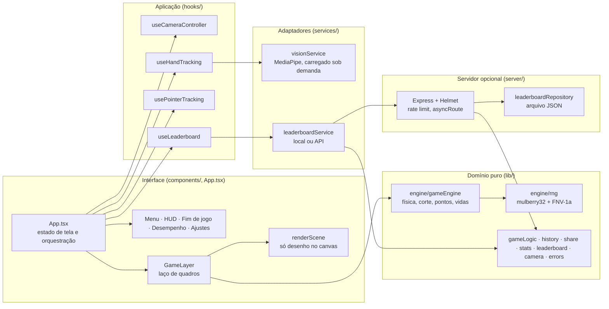

# Shadow Dojo: visão geral do projeto

O que o repositório faz, como faz e como as tecnologias novas entraram no ciclo de modernização de outubro de 2026. Para o histórico das versões 0.1 e 0.2, veja [`docs/EVOLUCAO.md`](docs/EVOLUCAO.md). Para o plano executivo e os próximos passos, veja [`MASTER_EVOLUTION_PLAN.md`](MASTER_EVOLUTION_PLAN.md).

## 1. O produto

Shadow Dojo é um jogo de corte no navegador, inspirado em Fruit Ninja (sem afiliação). Frutas sobem do fundo do palco e o jogador corta com:

- **a ponta do indicador diante da webcam**, rastreada no próprio navegador pelo HandLandmarker do MediaPipe (o vídeo nunca sai do aparelho);
- **o mouse ou o dedo** em telas de toque, sem câmera.

Regras: só um movimento corta (cursor parado não corta), cortes rápidos formam combos de até x5, uma bomba ou três frutas no chão encerram a partida.

Recursos de produto:

| Recurso | O que entrega |
|---|---|
| Desafio do dia | A mesma sequência de frutas para todos no mesmo dia, com link `?desafio=AAAA-MM-DD` |
| Seu desempenho | Histórico das últimas 100 partidas, KPIs, tendência, gráfico acessível por teclado e tabela equivalente |
| Compartilhar | Web Share API, com a área de transferência como alternativa |
| Ranking | No navegador (`localStorage`) no deploy estático; API Express opcional para desenvolvimento local |

Demo: <https://shadow-dojo.vercel.app> · Código: <https://github.com/matheussiqueira-dev/Clone-Fruit-Ninja>

## 2. Arquitetura

O projeto é um front-end estático (React 19 + Vite) com um servidor opcional. A separação segue o que o domínio pede: regras puras no centro, adaptadores para o que é externo (câmera, armazenamento, API) e a interface por fora.



### Camadas

| Camada | Pastas | Regra |
|---|---|---|
| Domínio | `lib/`, `lib/engine/` | Funções puras, sem DOM, React ou relógio. Tudo testado com Vitest. |
| Adaptadores | `services/` | Falam com o mundo externo (MediaPipe, `localStorage`, `fetch`). Trocáveis: o ranking escolhe local ou remoto por configuração. |
| Aplicação | `hooks/` | Liga entrada, câmera e persistência ao ciclo de vida do React. |
| Interface | `components/`, `App.tsx` | Telas e o canvas. O `GameLayer` só mede o palco, roda o `requestAnimationFrame` e entrega `engine.state` ao renderizador. |
| Servidor | `server/` | API opcional de ranking com o mesmo validador do front (`lib/leaderboard.ts`). |

### Injeção de dependências, na medida do domínio

Não há contêiner de DI: um jogo de navegador sem backend obrigatório não ganharia nada com ele. As dependências que mudam comportamento são injetadas por parâmetro:

- `createGameEngine({ rng, cosmeticRng, ... })`: o sorteio da partida e o dos efeitos são fontes separadas. O desafio diário injeta um gerador semeado; "efeitos reduzidos" não desalinha a sequência.
- `createFileLeaderboardRepository(path)` e `fetchLeaderboard` (local ou API) isolam a persistência.
- `loadVision()` carrega o módulo de visão só no modo câmera e pode ser trocado em testes.

## 3. Lógica central

### 3.1 O laço de quadros

```text
requestAnimationFrame
  → GameLayer lê a posição da lâmina (mão ou ponteiro, em coordenadas do palco)
  → engine.step(delta, agora, lâmina)          // domínio puro
      ├─ lança frutas pelo intervalo atual (planLaunch calcula o arco pela altura do palco)
      ├─ integra a física (delta limitado a 50 ms: uma pausa nunca teletransporta frutas)
      ├─ testa o segmento da lâmina contra cada fruta (distanceToSegmentSq)
      ├─ corta: metades na direção do corte, mancha de suco, combo, pontos
      └─ devolve só as estatísticas alteradas e o eventual fim de jogo
  → renderScene(ctx, engine.state)               // só desenho
```

Um salto grande entre duas amostras (mão reencontrada, toque novo) abre um traço novo em vez de cortar o que estiver no caminho.

### 3.2 Rastreamento da mão

1. `useCameraController` carrega o modelo primeiro e só então pede a câmera, para que uma falha de modelo nunca dispare o pedido de permissão.
2. `visionService` cria o `HandLandmarker` com delegate GPU e cai para CPU se a GPU falhar.
3. `useHandTracking` processa um quadro por quadro de vídeo novo (`requestVideoFrameCallback`, com `requestAnimationFrame` de reserva) e publica a ponta do indicador (landmark 8), espelhada se o ajuste pedir.
4. Cada falha tem mensagem própria: permissão negada, câmera ausente, câmera em uso, página sem acesso, modelo que não carregou, tempo esgotado. O modo mouse continua disponível em todas.

### 3.3 Desafio diário

A semente sai do dia local do jogador (`seedFromKey(dayKey())`, FNV-1a) e alimenta um mulberry32. Cada fruta consome sempre seis sorteios, então pontuações diferentes (que mudam a chance de bomba) não desalinham a sequência entre jogadores.

### 3.4 Persistência

Nada vindo do `localStorage` ou da rede é confiado: `normalizeHistory`, `normalizeLeaderboardEntries` e `isValidLeaderboardSubmission` validam tipo, faixa e formato na leitura. O servidor usa o mesmo validador do front.

### 3.5 Erros

- `ErrorBoundary` mantém a página utilizável quando a renderização falha.
- `lib/errors.ts` é o ponto único de relatório e captura `error` e `unhandledrejection`.
- No servidor, `asyncRoute` encaminha qualquer promessa rejeitada ao tratador de erros global, que responde 403 para CORS e 500 genérico para o resto.

## 4. Stack atual

| Área | Tecnologia | Versão | Licença |
|---|---|---|---|
| UI | React | 19.3 | MIT |
| Linguagem | TypeScript (`strict`) | 5.8 | Apache-2.0 |
| Build | Vite (Rolldown) + `@vitejs/plugin-react` | 8.3 / 6.1 | MIT |
| Estilo | Tailwind CSS via `@tailwindcss/vite`, mapeado para `ms-tokens.css` v1.0 | 4.3 | MIT |
| Visão computacional | MediaPipe Tasks Vision (HandLandmarker), WASM servido pelo próprio site | 1.1.1 | Apache-2.0 |
| Ícones e fonte | lucide-react, IBM Plex Sans (Fontsource) | 1.59 / 5.3 | ISC / OFL |
| Servidor opcional | Express + Helmet + CORS | 4.22 / 8.1 | MIT |
| Testes | Vitest + coverage v8, Playwright + axe-core | 4.1 / 1.64 / 4.14 | MIT / Apache-2.0 / MPL-2.0 |
| Qualidade | ESLint (typescript-eslint com tipos, react-hooks), Prettier | 10.13 / 3.9 | MIT |
| Runtime | Node.js | 24 no CI, mínimo 22.12 | MIT |
| Deploy | Vercel, site estático com CSP | n/a | n/a |

Tudo é open source e gratuito. A hospedagem usa o plano gratuito da Vercel.

## 5. Como as tecnologias novas entraram (outubro de 2026)

O projeto já tinha sido modernizado nas versões 0.1 e 0.2. Este ciclo tratou do que ainda estava atrasado ou sem proteção.

| Mudança | Por quê | Como foi validada |
|---|---|---|
| Atualizações dentro da faixa e `npm audit fix` | Fechar o alerta do esbuild e trazer React 19.3 | Suíte completa |
| `npm run sync:vision` + teste de hash | O JS do MediaPipe tinha subido para 0.10.35, mas o WASM servido era de 0.10.32: um descompasso que só aparece no modo câmera | O teste falha enquanto o runtime servido difere do pacote instalado |
| ESLint com tipos + Prettier + cobertura | Não havia lint. A primeira passada achou 19 problemas reais, entre eles um nome de jogador que virava `"[object Object]"` no ranking | Teste de regressão; piso de cobertura no CI |
| Tailwind 4 com o plugin do Vite | Remove PostCSS e autoprefixer e zera o `npm audit` (os alertas vinham da cadeia do Tailwind 3) | Diff de estilos computados de todas as telas em 375 e 1280 px |
| Vite 8 (Rolldown) | Build de 4 a 6 s para menos de 1 s, bundle principal 2,5% menor | Diff de estilos idêntico, suíte completa |
| MediaPipe 1.1.1 | Major atual do runtime de visão, mesma API | Teste novo carrega o modelo real e roda uma partida com câmera sintética |
| CSP de produção no `vite preview` | Antes, a suíte de ponta a ponta não aplicava a CSP do `vercel.json`, então um bloqueio de WASM passaria despercebido | Removendo `'wasm-unsafe-eval'` da CSP, o teste da câmera falha |
| CI em Node 24 com lint, formatação, cobertura e `npm audit` sem exceções | Node 20 sai de suporte; regressões de qualidade passam a bloquear o PR | Workflow em `.github/workflows/ci.yml` |

## 6. Qualidade em números

| Indicador | Valor |
|---|---|
| Testes unitários | 78 em 12 arquivos |
| Testes de ponta a ponta | 27 (Playwright, com axe em 320, 768 e 1280 px), todos sob a CSP de produção |
| Cobertura do domínio | 81,9% das instruções, 84,7% das linhas (piso no CI: 80%) |
| Erros de tipo / lint | 0 / 0 |
| `npm audit` | 0 alertas |
| JS inicial | 284 KB (90 KB gzip); visão computacional em chunk separado de 155 KB (46 KB gzip), só no modo câmera |
| Build de produção | menos de 1 s |

## 7. Rodar e verificar

```bash
npm ci
npm run dev              # http://localhost:3000
npm run dev:server       # ranking local opcional em :3333

npm run typecheck
npm run lint
npm run format:check
npm run test:coverage
npm run build
npm run e2e              # Playwright: Edge local, Chromium no CI
```

Depois de mudar a versão de `@mediapipe/tasks-vision`, rode `npm run sync:vision`.
